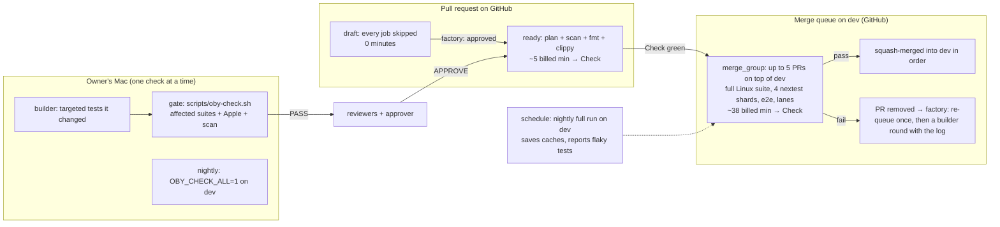

# CI architecture: test each change once, in batches

Status: **proposed** (2026-11-13). It replaces the plan in roadmap tasks R01-01 to R01-03 and adds
R01-12 to R01-14 (`factory/queue/tasks/`). Nothing here is built yet. Where it changes a rule only
the owner changes (AGENTS.md, a security path, the Mac check), it says so and waits for the owner's
word.

## In short

Think of a bakery that checks every loaf three times on its own and then once more, alone, after
it is already on the shelf. This design checks a loaf once, before it goes out, and checks a whole
tray at a time.

1. **A pull request costs almost nothing on GitHub until it is ready to merge.** Drafts run no jobs.
   A ready pull request runs only fmt, clippy and the secret scan (about 5 billed minutes).
2. **The full Linux suite runs once per batch, in GitHub's merge queue on `dev`.** Up to 5 pull
   requests are put on top of `dev` together and tested as one, then squash-merged in order. That
   is what catches the #2152 kind of miss (a merge that broke tests its own change never ran).
3. **The Mac check stays the gate a pull request needs before it is reviewed**, and runs what only a
   Mac runs or what the change reaches. It no longer runs a second time after syncing with `dev`:
   the queue now tests the combined code on Linux. A full Mac run of `dev` happens once a night.
4. **Flaky tests are retried in CI only when they are on one shrink-only list**, each with a task to
   fix it. A test that is flaky but not listed still fails.
5. **Everything runs on GitHub's standard Linux runners.** No macOS runners and no larger runners:
   those are billed even on a public repository. No self-hosted runner.

## What exists today, measured

### Money: `oby` is not what is spending it

`obi-ai-bot/oby` is public and runs on standard hosted runners, which GitHub bills at $0 for public
repositories ([GitHub Actions billing](https://docs.github.com/en/billing/concepts/product-billing/github-actions):
"The use of standard GitHub-hosted runners is free" in public repositories). The org's own usage
report agrees. It comes from `GET /organizations/obi-ai-bot/settings/billing/usage`, which replaced
the old `/orgs/{org}/settings/billing/actions` (that one now answers 410)
([billing usage API](https://docs.github.com/en/rest/billing/usage)). Read on 2026-11-13:

| Org · repository | Month | Runner | Minutes | List price | Billed |
|---|---|---|---:|---:|---:|
| obi-ai-bot · oby | Oct 2026 | Linux | 1,951 | $11.71 | $1.87 (Oct 14–16 only) |
| obi-ai-bot · oby | Oct 2026 | macOS 3-core | 282 | $17.50 | $17.50 |
| obi-ai-bot · oby | Oct 21–31 | Linux | 1,639 (1,490 on Oct 27) | $9.83 | **$0.00** |
| obi-ai-bot · oby-sphere | Oct 2026 | Linux + macOS | 1,492 | $34.82 | $1.43 |
| obi-ai-bot · all | Nov 1–13 | Linux + macOS | 182 | $3.72 | **$0.00** |
| **deskree-inc · all** | **Oct 2026** | Linux 64,189 · macOS 1,243 · Windows 4,439 | 69,871 | $506.60 | **$202.06** |
| deskree-inc · tetrix-collectors | Oct 2026 | | 32,686 | | $133.08 |
| deskree-inc · oberon | Oct 2026 | | 26,655 | | $30.02 |

So, in October:

- `oby`'s Linux minutes were billed only on October 14–16, and $0 from October 21 on, 1,490 minutes
  in one day included. That fits the repository going public around then. I could not confirm
  the date: GitHub's API gives no "made public" event for it.
- What `oby` paid for was **macOS runner minutes** ($17.50), which no workflow here uses any more.
- The bill that "exploded" is **deskree-inc's private repositories**: 64,189 Linux minutes, $202
  billed, mostly `tetrix-collectors` and `oberon`. That is a separate problem, with its own fix.
  This design keeps `oby` at $0 and doesn't touch deskree-inc.

What `oby` is short of is not money: it is **the Mac's time, CI that gates nothing, and shared
concurrency**.

### The Mac gate is the factory's real limit

From the factory's own records (`factory/jobs/*/round-*/checks.md` and `merge-checks.md` on the
owner's Mac), across the 13 jobs run on 2026-11-13:

- **27 gate runs took 286 minutes**: 10.6 minutes on average, 46 s to 30 min. Every one held the
  one check lock (`factory/checks.sh`). That doesn't count the builder's own runs before it says
  READY.
- 8 pull requests merged. That is **about 36 Mac minutes per merged pull request**, always one at a
  time. At 20 pull requests a day it would take **12 hours of Mac a day**. Four jobs can run at
  once, but their gates can't: the gate, not the agents, sets the factory's pace.
- 5 of the 27 gates failed. **4 of those 5 were known flaky tests**:
  - `merging_39_a_second_red_head_asks_the_owner`, twice
  - `a_turn_says_it_is_thinking_within_half_a_second` (#1804)
  - `codex::tests::a_command_ends_the_codex_process_at_once`
  - `plans_map_replies_cancellations_and_dispatched_jobs`

  Each one cost a full builder round and another gate.

### GitHub CI runs today, but decides nothing

`.github/workflows/linux.yml` runs everything on every non-draft pull request and on every push to
`dev` and `main`. Its jobs: Rust fmt, clippy and the whole suite, gitleaks, the control plane, and
`make e2e`. On 2026-10-27 a green run took 13 minutes of Rust plus about 3 more; call it 18–20 billed
minutes. That was before today's suite. The factory never waits for it:

1. `factory/bin/job merge` calls `gh pr ready` and then, at once, `gh pr merge --squash`.
2. `dev` has no branch protection (`gh api …/branches/dev/protection` answers 404), so the merge
   lands before CI starts.
3. The run that `ready_for_review` started then tests a pull request that is already merged.
4. The push to `dev` starts another run, which nobody reads.
5. Its caches are saved under `refs/pull/<n>/merge`, which no other pull request can read: 464 MB
   wasted from #2154 alone ([dependency caching](https://docs.github.com/en/actions/reference/workflows-and-actions/dependency-caching)).

**Today GitHub runs about 2.5 full runs per factory pull request, and none of them can stop a
merge.**

## The design

### Who runs what, once

| Where | When | What it runs | Why there |
|---|---|---|---|
| The builder, on the Mac | while it works | the test binaries it touched (`cargo test --test <x>`), Electron's typecheck if touched | fast feedback; it isn't a gate |
| The gate, on the Mac | once per round, on the pull request's head | `scripts/oby-check.sh` as now: affected Rust, Electron, Swift/iOS, gitleaks | the Mac's own suites (Seatbelt, Keychain, Swift, iOS) exist only there; it is "fit to review" |
| GitHub, pull request (ready) | when the factory approves, once per head | plan, gitleaks, `cargo fmt --check`, `cargo clippy --workspace --all-targets -D warnings` | cheap admission to the queue; a clippy error caught here doesn't sink a batch |
| GitHub, merge queue | once per batch of ≤5 pull requests | everything the batch's combined diff reaches, in coarse lanes: all of the Rust suite for any `core/` change, e2e, control plane, Electron | the only place the combined code is tested before it lands; catches #2152 |
| GitHub, nightly on `dev` | 03:17 UTC and on demand | everything, every lane | saves the caches the other runs read; finds flaky tests; a daily full signal |
| The factory, nightly on the Mac | once a day when no gate waits | `OBY_CHECK_ALL=1 scripts/oby-check.sh` on `origin/dev` | the Mac-only suites on the code as merged |

So each Rust test runs **once per batch on Linux**, plus the affected ones **once per pull request
on the Mac**. Today it is 2–4 times on the Mac and 2–3 times on GitHub, per pull request.

### Trigger matrix

There is one workflow file, `ci.yml`, which replaces `linux.yml`. It has no workflow-level path
filter, so the required check `Check` always reports. GitHub leaves a check skipped by a path
filter "Pending", which blocks merging
([workflow syntax](https://docs.github.com/en/actions/reference/workflows-and-actions/workflow-syntax)).
Jobs are skipped with `if:` instead, and a skipped job reports success
([troubleshooting required checks](https://docs.github.com/en/pull-requests/collaborating-with-pull-requests/collaborating-on-repositories-with-code-quality-features/troubleshooting-required-status-checks)).

Lanes come from the paths a change touches. In the merge queue, that is the group's whole diff,
`merge_group.base_sha..head_sha`.

| Lane | Paths that reach it |
|---|---|
| `rust` | `core/**`, `docs/api/**` (route guard), `e2e/**`, `Makefile` |
| `e2e` | `core/**`, `e2e/**`, `Makefile` |
| `electron` | `apps/electron/**` |
| `control-plane` | `cloud/control-plane/**` |
| `tools` | `tools/oby-check-blok/**` (its own Cargo workspace) |
| every lane | `.github/**`, `scripts/oby-check*`, `core/Cargo.lock`, `core/Cargo.toml`, `rust-toolchain*` |
| no lane (plan and scan only) | `docs/**`, `factory/**`, `.claude/**`, `*.md`, `design/**`, `character/**`, `apps/ios/**`, `apps/watch/**`, `apps/shared/**`, `apps/Oby.xcodeproj/**`, `mcp/**` (Mac only) |

Which jobs run for which event:

| Event | `plan` + gitleaks | `lint` (fmt, clippy) | `rust-build` + 4 × `rust-test` | `e2e` | `electron`, `control-plane`, `tools` | `Check` | Cancels older runs |
|---|---|---|---|---|---|---|---|
| `pull_request`, draft | — | — | — | — | — | skipped (GitHub won't queue a draft) | yes |
| `pull_request`, ready, into `dev` | ✓ | ✓ if `rust` | — | — | — | ✓ | yes, per PR |
| `pull_request` with label `full-ci` | ✓ | ✓ | ✓ if `rust` | ✓ if `e2e` | ✓ per lane | ✓ | yes, per PR |
| `pull_request` into `main` | ✓ | ✓ | ✓ | ✓ | ✓ | ✓ | yes, per PR |
| `merge_group` (queue on `dev`) | ✓ | ✓ if `rust` | ✓ if `rust` | ✓ if `e2e` | ✓ per lane | ✓ | never |
| `schedule` (nightly, `dev`), `workflow_dispatch` | ✓ | ✓ | ✓ | ✓ | ✓ | ✓, and saves caches | never |
| `push` to `dev` or `main` | — | — | — | — | — | — | — (dropped: the queue already tested that exact commit) |

`Check` has `needs:` on every job and `if: always()`. It fails when any needed job failed or was
cancelled, or when `plan` failed. That way a skipped lane can't hide a broken plan (R01-02's CI-5
and CI-6 hold).

### The merge queue on `dev`

`dev` is this repository's default branch, and the queue is open to public repositories owned by
an organization ([merge queue](https://docs.github.com/en/pull-requests/how-tos/merge-and-close-pull-requests/merging-a-pull-request-with-a-merge-queue)).
The proposed settings are a repository ruleset on `dev`. "Require merge queue" is repository-level
only ([rulesets](https://docs.github.com/en/repositories/configuring-branches-and-merges-in-your-repository/managing-rulesets/available-rules-for-rulesets)).

| Setting | Value | Why |
|---|---|---|
| Merge method | squash | The remembered workflow for this repository (AGENTS.md). |
| Build concurrency | 1 | No speculative group that a failure throws away. One group about every 15 minutes merges up to 5 pull requests, about 20 an hour, far more than the factory makes. |
| Minimum group size, wait time | 2, 15 minutes | Batches what arrives together: four jobs often finish close together. A lone pull request still goes after 15 minutes. |
| Maximum group size | 5 | A failure throws away at most 5 pull requests' worth of run. |
| Require all entries to pass | on | A pull request whose group failed never merges. |
| Status check timeout | 60 minutes | Twice the batch's expected time. |
| Required status check | `Check` | The one aggregate job. |
| Required approvals | 0 | The factory and obid review by themselves; GitHub's approvals stay the owner's choice ("Oby forbids nothing"). |

`main` gets only a required `Check` and no queue. Pull requests into `main` are rare and the
owner's; they run everything.

**When a batch fails.** GitHub documents that it removes the failing pull request and rebuilds the
others behind it. It doesn't document bisecting, and it doesn't say how it picks the one to blame
inside a single group of several (I could not confirm either:
[managing a merge queue](https://docs.github.com/en/enterprise-cloud@latest/repositories/configuring-branches-and-merges-in-your-repository/configuring-pull-request-merges/managing-a-merge-queue)).
So the factory does its own cheap bisect:

1. A pull request removed from the queue is queued again once, by itself, with no builder round.
   Something else in its group may have been at fault.
2. If it fails again, the job gets a builder round with the failed log quoted as data, as obid's
   MERGING-39 does, and the pull request goes back to draft.
3. A removal for a conflict sends it straight to a builder round that merges `dev`.

**How merges reach the queue.**

- `gh pr merge` "automatically adds the pull request to the queue if required checks have passed",
  and otherwise turns on auto-merge, which queues it later (same merge-queue page).
- The REST `PUT /pulls/{n}/merge` doesn't merge into a queue ([pulls API](https://docs.github.com/en/rest/pulls/pulls)).
  That is the case obid's MERGING-41 already handles: when GitHub refuses a merge because the base
  takes pull requests only through its queue, obid calls `gh pr merge --auto --match-head-commit`,
  which queues it. **obid needs no code change.** R01-03 proves it on one real job.
- `PUT /pulls/{n}/merge-async` with `merge_action: merge_queue` is the newer REST route (same
  page). It is not needed now.

### Each run's cost

| Lever | Choice |
|---|---|
| Runner | `ubuntu-latest` standard (4 vCPU on public repositories). Never `macos-*`, never larger runners: "Larger runners are billed for public repositories" ([billing](https://docs.github.com/en/billing/concepts/product-billing/github-actions)). |
| Build once, test in shards | `rust-build` runs `cargo nextest archive --workspace` and uploads it (retention 1 day). Four `rust-test` jobs run `cargo nextest run --archive-file … --partition slice:k/4` ([archiving](https://nexte.st/docs/ci-features/archiving/), [partitioning](https://nexte.st/docs/ci-features/partitioning/): `count:` is deprecated for `slice:`). That is one compile, not four. |
| Rust cache | `Swatinem/rust-cache` with `save-if` true only for `schedule` and `workflow_dispatch`. It saves on every branch by default ([rust-cache](https://github.com/Swatinem/rust-cache)). Runs on pull requests and in the queue only restore, from `dev`, the default branch, which any run may read. One `shared-key` per job kind: lint, test build, e2e. The workspace crates themselves are never cached, so obid compiles in every run. sccache wouldn't help there, since obid is one crate any change rebuilds. |
| Cache budget | 10 GB per repository, least recently used first, 7 days unused ([caching](https://docs.github.com/en/actions/reference/workflows-and-actions/dependency-caching)). Three Rust keys and the node caches fit in about 4–5 GB. Today's pull-request caches can't be shared and churn it. |
| Concurrency | `pull_request` runs cancel older runs of the same pull request, as today. `merge_group` and nightly runs never cancel. |
| Flaky tests | A nextest `ci` profile: `retries = 1` for every test in the queue and at night; `retries = 2` for tests on the quarantine list ([retries](https://nexte.st/docs/features/retries/)). JUnit per shard; a test that passed on retry shows as `flakyFailure` ([JUnit](https://nexte.st/docs/machine-readable/junit/)), and `Check`'s summary lists it. |

The nightly run tests everything, so it catches what lane-skipping in the queue might miss: a
change under `apps/` that a Rust test reads, say.

### What changes in the factory

These are tasks R01-12 and R01-14. Files under `.claude/` are a security path, so those pull
requests wait for the owner.

1. **Pull requests stay drafts until the approver says APPROVE.** The builder already opens drafts.
   Going to `needs-human` no longer marks a pull request ready (`factory/bin/job`, `advance`); the
   owner or the merge marks it. So every round's push runs no GitHub jobs.
2. **`job merge` queues instead of syncing, gating and merging.** It runs `gh pr ready`, then
   `gh pr merge <n> --auto --match-head-commit <head>`, which queues the pull request once `Check`
   is green on the pull request, and goes to a new waiting stage, `queued`. `job queue` reads
   queued jobs at most once every 2 minutes:
   - merged → `merged`
   - removed → re-queue once, then a builder round with the log, then `needs-human` when the rounds
     run out (as now)
   - conflict → a builder round
3. **The merge gate goes.** With no sync there is nothing new to test on the Mac: the head is the
   one the gate passed, and `factory/bin/gate --merge`'s reuse rule from #2160 already passes it
   without running the check. This changes a rule only the owner changes: AGENTS.md says a pull
   request into `dev` merges after "the checks on the user's Mac pass on the same commit". **The
   owner decided it on 2026-11-13: "Yes, drop the Mac merge gate".** From R01-12 on, the Mac check
   passes the pull request's own head. The merged code is tested by the queue's full Linux suite
   and, nightly, by the full Mac check. R01-12 rewrites AGENTS.md's line to say so.
4. **The builder runs targeted tests, not the whole check.** The gate runs the check right after
   it (`.claude/agents/builder.md`).
5. **A nightly full Mac run on `dev`** (R01-14, built: `factory/bin/nightly`): when no gate is
   waiting, `OBY_CHECK_ALL=1 scripts/oby-check.sh origin/dev` in a worktree of its own, under the
   same lock. A failure tells the owner and writes a fix task file. The factory opens no GitHub
   issue.
6. Unchanged: `factory/checks.sh`, its lock and shared Cargo folder, `concurrency: 4`, the reviewers.

### Flaky tests: one list that only shrinks

- The list lives in `core/.config/nextest.toml` (`[[profile.ci.overrides]]`, one `filter` naming
  one exact test, `retries = 2`, and a comment naming its fixing task). The Mac check reads the
  same list and re-runs a failed test once only if it is on it, at the merge base and in the
  change (docs/contracts/ci.md, CI-26 to 28).
- Built in R01-13: the list, the retry for obid's test binaries and lib tests, and a guard in
  `scripts/oby-check.sh` that fails `the flaky list` when an entry comes without the task file the
  same change adds. Only `scripts/oby-check.sh` changed of the check's files: `tools/oby-check-blok`
  relays the script's lines and takes its exit status, so it needed nothing. The owner accepted on
  2026-11-13 ("merge #2163 and accept all three decisions") that R01-13 merges on approval,
  though it changes the check's own files.
- An entry needs a task that fixes it. R01-06 fixed #1656 and #1804, and A00-01 the other
  `plans_api` test, so neither is listed. R01-13 listed the six tests the factory's gate logs and
  builders' notes showed failing on changes that didn't touch them, with tasks R01-15 to R01-19.
- Fixing a test removes its line. The list never grows without a task, and nothing is retried
  blind on the Mac.

## Minutes, before and after (≈20 factory pull requests a day)

These are estimates. Inputs:

- a full run of today's `linux.yml` ≈ 19 billed minutes (13 min of Rust on 2026-10-27, plus e2e,
  control plane and scan, each rounded up to the minute)
- a batch run ≈ 38 billed minutes:
  - plan 1, lint 3, build 7
  - 4 shards × 5
  - e2e 3, control plane 1, Electron 2, Check 1
- groups average 2.5 pull requests, and 25% of groups fail and run again
- Mac gates average 10.6 minutes (measured)

| | Today, Actions on | This design |
|---|---|---|
| GitHub runs per pull request | ≈2.5 full (ready, later pushes, push to `dev`) | 1 lint run + ⅖ of a batch (×1.25 for failures) |
| GitHub billed minutes per pull request | ≈45–55 | ≈5 + ≈19 = **≈24** |
| GitHub billed minutes per day | **≈950–1,100** | 20 × 24 + nightly 40 ≈ **≈520** |
| Dollars per day (public, standard runners) | $0 (list price ≈ $6) | $0 (list price ≈ $3) |
| GitHub runs that can stop a bad merge | none | every batch |
| Mac gate minutes per pull request | ≈25–36 (2–3 gates, one at a time) | ≈11–14 (1–1.3 gates) |
| Mac gate hours per day | ≈8–12 (more than the day allows at 20/day) | ≈4–5, plus a 30-minute nightly |
| Peak concurrent GitHub jobs | 4 per run, several runs at once | ≤8 for the one batch, plus 2–3 per ready pull request |
| Time from APPROVE to merged | seconds (no gate) | ≈15–35 min (wait for the group, then about 15 min of run) |

The last row is the price: a merge now waits for a batch to be tested. Factory jobs don't sit idle
for it, because `queued` is a waiting stage and the slot goes to the next task.

## Limits, and how this stays inside them

| Limit | Value | This design |
|---|---|---|
| Concurrent jobs, standard runners | 500 on Enterprise (20 Free, 60 Team); macOS 50 ([limits](https://docs.github.com/en/actions/reference/limits)) | ≤8 for one batch. Whether the 500 is shared with deskree-inc's 64k-minute month is undocumented (could not confirm). Either way `oby` adds little. |
| Job time | 6 h per job, 35 days per run | Shards run about 5 min; the batch has a 60-minute timeout. |
| Matrix | 256 jobs | 4 shards. |
| `GITHUB_TOKEN` REST | 1,000 per hour per repository (15,000 for Enterprise Cloud) ([rate limits](https://docs.github.com/en/rest/using-the-rest-api/rate-limits-for-the-rest-api)) | 1–3 calls per run (paths filter). |
| The owner's `gh` token | 5,000 REST per hour; 5,000 GraphQL points per hour; secondary limits of 100 concurrent requests and 80 content-creating requests per minute (same pages) | The factory reads a queued job at most every 2 minutes: 4 jobs × 30 = 120 a hour. obid's MERGING-41 reads every 30 s for 10 min after arming, then every 180 s. Both share this token. |
| Cache | 10 GB per repository; above that is billed only with a payment method | Only `dev` saves: ≈4–5 GB. |
| Artifacts | public: 1–90 days retention | nextest archive 1 day; JUnit 14 days. Free on a public repo: likely, but not confirmed. |
| Queue throughput | 500 queued runs per 10 s per repository | Far below. |

## Risks

| Risk | How bad | What the design does |
|---|---|---|
| A batch fails on a flaky test and removes good pull requests | Medium: a lost batch is about 38 min and a re-queue | `retries = 1` in the queue, the quarantine list, and the factory's re-queue-once. |
| GitHub blames the wrong pull request in a multi-PR group (undocumented) | Low | Re-queue once alone before any builder round; maximum group size 5. |
| Lanes in the queue skip a test a change reaches through a path not in the table | Low | Coarse lanes (any `core/` change runs all of Rust), every lane for CI and toolchain files, and the nightly full run. |
| Mac-only breakage merged (Seatbelt, Keychain, Swift) between nightly runs | Medium, until the nightly | The nightly Mac run, and the gate still runs the affected Mac suites on each head. The owner accepted this risk on 2026-11-13 by dropping the Mac merge gate. |
| nextest's process-per-test model changes how obid's tests behave | Low: the statics found guard production code, not tests; `tests/swift_client.rs` builds once per process | R01-02 spikes it first. Its fallback, shards by test binary, is already in that task. |
| The archive misses `CARGO_BIN_EXE_obid` or fixtures under `tests/` | Low | `--workspace-remap` to the checkout; R01-02's spike proves it. |
| The queue blocks all merges if `ci.yml` breaks | High, but visible | `Check` fails loudly. A change to `.github/` runs every lane, and the owner's ruleset bypass stays theirs. |
| Concurrency shared with deskree-inc's private-repo storms | Unknown | Small footprint. If queue waits show up, ask GitHub Support, or fix deskree-inc's CI. |
| Public repository with a self-hosted runner | n/a | None proposed. A fork's `pull_request` runs the fork's workflow file, so a runner label is no barrier. |

## Rollout order

Each step is safe alone and makes the next one possible.

1. **R01-01, today's file made honest** (no new infrastructure):
   - drop the `push` runs, which the queue will replace and which nobody reads today
   - add the nightly `schedule` and `workflow_dispatch`
   - caches saved only by those
   - list today's red tests (clippy `Started` never constructed, on #2154) in the pull request
   - rewrite `docs/ci.md`

   GitHub minutes drop by about half at once.
2. **R01-13, the quarantine list**, and **R01-06**, which fixes the flaky tests the list names.
3. **R01-02, `ci.yml`**: plan, lanes, lint, archive and 4 shards, e2e, Electron, control plane, and
   the `Check` aggregator, with its PR, queue and nightly modes. Proven on throwaway branches,
   including a red shard and a red plan.
4. **R01-12, the factory queues**: drafts until APPROVE, `queued` stage, re-queue once, merge gate
   reused. It works with or without a queue: `gh pr merge --auto` merges at once when nothing holds
   it. Its merge-gate drop is decided (item 3 above).
5. **R01-03, the owner's step**: a ruleset on `dev` (queue and required `Check`) and a required
   `Check` on `main`. It goes on only after R01-12, or every factory merge would go to needs-human.
   Then one real obid job goes through MERGING-41's path into the queue, and one factory job too.
6. **R01-14, the nightly full Mac run** by the factory. It can go any time.
7. **R01-11, the CLI canary**: scheduled only, not a required check, its own concurrency group.
   Unchanged.

## What I could not verify

- Whether GitHub's 500-job concurrency limit is per org or per enterprise, and so whether
  deskree-inc's runs compete with `oby`'s.
- How GitHub picks which pull request to remove when a multi-PR group fails, and whether it bisects.
- The cache scope of `merge_group` runs (`gh-readonly-queue/dev/…` refs). The design relies only on
  restoring from `dev`, the default branch, which any run may read.
- Whether artifact storage is free on public repositories.
- The date `oby` became public. Billing points to between October 16 and 21.
- Whether `obi-ai-bot`'s Enterprise allowance ($300 a month of compute) is shared with deskree-inc.
  October's deskree-inc bill suggests a shared pool ran out early in the month.
- The minute figures above are estimates from one October run and today's gate logs. A green
  `ci.yml` batch is the first real measurement.
- `count:` vs `slice:` in the nextest version the runner installs. R01-02 pins a version.
