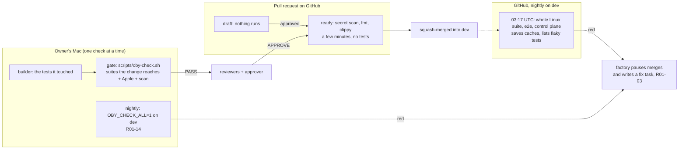

# CI architecture: the Mac gates each change, GitHub tests dev nightly

Status: **decided by the owner on 2026-11-13, partly built.** "Go with the leaner option, nightly
only", and "Yes, drop the Mac merge gate". #2166 and #2167 put the GitHub side in place. Roadmap
tasks R01-01 to R01-03 are rewritten to fit, and R01-12 to R01-14 are new
(`factory/queue/tasks/`). Where something changes a rule only the owner changes (AGENTS.md, a
security path, the Mac check), it says so.

## In short

Think of a bakery where every loaf was checked three times on its own, and then once more after it
was already on the shelf. Now each loaf is checked once before it goes out, and the whole shelf is
checked every night.

1. **Each pull request is tested once, on the Mac.** The Mac check (`scripts/oby-check.sh`) runs
   the suites the change reaches, the Apple suites included, on the pull request's head. It no
   longer runs a second time after syncing with `dev`.
2. **GitHub runs no tests on a pull request.** It runs the secret scan and, for a Rust change, fmt
   and clippy: a few minutes. The `full-ci` label asks for everything.
3. **GitHub tests `dev` as merged once a night.** The whole Linux suite, e2e and the control plane
   run at 03:17 UTC, or on demand. That is where a break that only shows up once changes are
   combined (the #2152 kind) is found, **within a day rather than before the merge**. That is the
   trade-off the owner chose.
4. **A red night stops the factory's merges** until a fix lands (R01-03). The factory also runs the
   full Mac check of `dev` nightly (R01-14).
5. **Flaky tests are retried only when they are on one shrink-only list**, each with a task to fix
   it.
6. **Standard Linux runners only.** No macOS runners, no larger runners (both are billed even on a
   public repository), and no self-hosted runner.

## What exists today, measured

### Money: `oby` is not what is spending it

`obi-ai-bot/oby` is public and runs on standard hosted runners, which GitHub bills at $0 for public
repositories ([GitHub Actions billing](https://docs.github.com/en/billing/concepts/product-billing/github-actions):
"The use of standard GitHub-hosted runners is free" in public repositories). The org's own usage
report agrees. It comes from `GET /organizations/obi-ai-bot/settings/billing/usage`, which replaced
the old `/orgs/{org}/settings/billing/actions` (that one now answers 410)
([billing usage API](https://docs.github.com/en/rest/billing/usage)). Read on 2026-11-13:

| Org · repository | Month | Runner | Minutes | List price | Billed |
|---|---|---|---:|---:|---:|
| obi-ai-bot · oby | Oct 2026 | Linux | 1,951 | $11.71 | $1.87 (Oct 14–16 only) |
| obi-ai-bot · oby | Oct 2026 | macOS 3-core | 282 | $17.50 | $17.50 |
| obi-ai-bot · oby | Oct 21–31 | Linux | 1,639 (1,490 on Oct 27) | $9.83 | **$0.00** |
| obi-ai-bot · oby-sphere | Oct 2026 | Linux + macOS | 1,492 | $34.82 | $1.43 |
| obi-ai-bot · all | Nov 1–13 | Linux + macOS | 182 | $3.72 | **$0.00** |
| **deskree-inc · all** | **Oct 2026** | Linux 64,189 · macOS 1,243 · Windows 4,439 | 69,871 | $506.60 | **$202.06** |
| deskree-inc · tetrix-collectors | Oct 2026 | | 32,686 | | $133.08 |
| deskree-inc · oberon | Oct 2026 | | 26,655 | | $30.02 |

So, in October:

- `oby`'s Linux minutes were billed only on October 14–16, and $0 from October 21 on, 1,490 minutes
  in one day included. That fits the repository going public around then. I could not confirm
  the date: GitHub's API gives no "made public" event for it.
- What `oby` paid for was **macOS runner minutes** ($17.50), which no workflow here uses any more.
- The bill that "exploded" is **deskree-inc's private repositories**: 64,189 Linux minutes, $202
  billed, mostly `tetrix-collectors` and `oberon`. That is a separate problem, with its own fix.
  This design keeps `oby` at $0 and doesn't touch deskree-inc.

What `oby` is short of is not money: it is **the Mac's time, and CI that gates nothing**.

### The Mac gate is the factory's real limit

From the factory's own records (`factory/jobs/*/round-*/checks.md` and `merge-checks.md` on the
owner's Mac), across the 13 jobs run on 2026-11-13:

- **27 gate runs took 286 minutes**: 10.6 minutes on average, 46 s to 30 min. Every one held the
  one check lock (`factory/checks.sh`). That doesn't count the builder's own runs before it says
  READY.
- 8 pull requests merged. That is **about 36 Mac minutes per merged pull request**, always one at a
  time. At 20 pull requests a day it would take **12 hours of Mac a day**. Four jobs can run at
  once, but their gates can't: the gate, not the agents, sets the factory's pace.
- 5 of the 27 gates failed. **4 of those 5 were known flaky tests**:
  - `merging_39_a_second_red_head_asks_the_owner`, twice
  - `a_turn_says_it_is_thinking_within_half_a_second` (#1804)
  - `codex::tests::a_command_ends_the_codex_process_at_once`
  - `plans_map_replies_cancellations_and_dispatched_jobs`

  Each one cost a full builder round and another gate.

### GitHub CI ran, but decided nothing (before #2166)

`.github/workflows/linux.yml` ran everything on every non-draft pull request and on every push to
`dev` and `main`. Its jobs: Rust fmt, clippy and the whole suite, gitleaks, the control plane, and
`make e2e`. On 2026-10-27 a green run took 13 minutes of Rust plus about 3 more; call it 18–20 billed
minutes. That was before today's suite. The factory never waits for it:

1. `factory/bin/job merge` calls `gh pr ready` and then, at once, `gh pr merge --squash`.
2. `dev` has no branch protection (`gh api …/branches/dev/protection` answers 404), so the merge
   lands before CI starts.
3. The run that `ready_for_review` started then tests a pull request that is already merged.
4. The push to `dev` starts another run, which nobody reads.
5. Its caches are saved under `refs/pull/<n>/merge`, which no other pull request can read: 464 MB
   wasted from #2154 alone ([dependency caching](https://docs.github.com/en/actions/reference/workflows-and-actions/dependency-caching)).

**GitHub ran about 2.5 full runs per factory pull request, and none of them could stop a
merge.** Every one of them was also red on 2026-11-13, for one Linux-only clippy error that the
Mac never saw (fixed by #2165).

## The design

### Who runs what, once

| Where | When | What it runs | Why there |
|---|---|---|---|
| The builder, on the Mac | while it works | the test binaries and suites it touched | fast feedback; it isn't a gate |
| The gate, on the Mac | once per round, on the pull request's head | `scripts/oby-check.sh`: the Rust, Electron and Swift/iOS suites the change reaches, then gitleaks | the one test run per pull request; the Mac's own suites exist only there |
| GitHub, pull request | when it isn't a draft | secret scan; fmt and clippy for a Rust change (Linux-only code included: #2165's error) | cheap; catches what the Mac's build can't see |
| GitHub, nightly | 03:17 UTC on `dev`, and `workflow_dispatch` | everything: `cargo test --workspace`, `make e2e`, the control plane | `dev` as merged, on Linux; the only run that saves caches |
| The factory, nightly | once a day when no gate waits (R01-14) | `OBY_CHECK_ALL=1 scripts/oby-check.sh` on `origin/dev` | the Mac-only suites on `dev` as merged |

### Trigger matrix (`linux.yml` after #2166 and #2167)

The `Changes` job reads which paths a pull request touches:

- **Rust lane:** anything but docs (not `docs/api`), `factory/`, `.claude/`, `design/`,
  `character/`, `apps/ios`, `apps/watch`, other `cloud/` and Markdown.
- **Cloud lane:** `cloud/control-plane/` or `.github/`.
- **Tests:** only off pull requests, or with the `full-ci` label.

A skipped job reports success, and nothing is a required check.

| Event | Secret scan | fmt + clippy | `cargo test` | `make e2e` | Control plane | Saves caches |
|---|---|---|---|---|---|---|
| `pull_request`, draft | — | — | — | — | — | no |
| `pull_request`, ready | ✓ | ✓ if Rust lane | — | — | — | no |
| `pull_request` with label `full-ci` | ✓ | ✓ if Rust lane | ✓ if Rust lane | ✓ if Rust lane | ✓ if cloud lane | no |
| `schedule` (nightly on `dev`), `workflow_dispatch` | ✓ | ✓ | ✓ | ✓ | ✓ | **yes** |
| `push` to `dev` or `main` | — | — | — | — | — | — |

### The nightly run must be read

A nightly run nobody reads is the old problem again. GitHub notifies whoever last changed the
workflow's schedule, but the factory merges all day. So R01-03 makes the factory itself read it:

1. Before each merge, `factory/bin/job` reads the latest `schedule` run of `linux.yml` on `dev`.
2. If that run is red and no fix has merged since, the job waits in `needs-human`, saying which
   tests failed.
3. The orchestrator writes one fix task file naming those tests, in the queue's format.

The factory reads and writes no GitHub issue.

### Each run's cost

| Lever | Choice |
|---|---|
| Runner | `ubuntu-latest` standard. Never `macos-*` or larger runners: "Larger runners are billed for public repositories" ([billing](https://docs.github.com/en/billing/concepts/product-billing/github-actions)). |
| Rust cache | `Swatinem/rust-cache` saves only on `schedule` and `workflow_dispatch` (#2166); every other run restores from `dev`, the default branch, which any run may read ([caching](https://docs.github.com/en/actions/reference/workflows-and-actions/dependency-caching)). |
| Cache budget | 10 GB per repository, least recently used first, 7 days unused. The nightly keys fit in a few GB. |
| Pull-request runs | `cancel-in-progress` per pull request, as before. |
| Nightly test report | R01-02: `cargo nextest` with a `ci` profile, JUnit uploaded, retries for listed flaky tests. Sharding isn't needed: one nightly run's time doesn't hold anyone up. |

### What changes in the factory

These are tasks R01-12, R01-03 and R01-14. Files under `.claude/` and AGENTS.md are security
paths, so those pull requests wait for the owner.

1. **Pull requests stay drafts until the approver says APPROVE.** Going to `needs-human` no longer
   marks a pull request ready, so a round's pushes start no GitHub run.
2. **No Mac merge gate.** The owner decided it on 2026-11-13: "Yes, drop the Mac merge gate".
   - `job merge` stops syncing with `dev` and re-running the check. It marks the pull request ready
     and squash-merges the head the gate passed.
   - A conflict with `dev` still stops it: GitHub refuses the merge, and the job gets a builder
     round that merges `dev`.
   - AGENTS.md's remembered workflow changes to "the Mac check passed on the pull request's head",
     with `dev` tested as merged nightly.
3. **The builder runs only the tests it touched.** The gate runs the whole check right after it.
4. **A red nightly pauses merges** (R01-03, above), and **the factory runs the full Mac check of
   `dev` nightly** (R01-14), with the same pause on red.
5. Unchanged: `factory/checks.sh`, its lock and shared Cargo folder, `concurrency: 4`, the reviewers.

### Flaky tests: one list that only shrinks

- The list lives in `core/.config/nextest.toml` (`[[profile.ci.overrides]]`, one `filter` per test,
  `retries = 2`). The nightly reads it, and so does the Mac check, which re-runs a failed test once
  only if it is listed (R01-13). That changes the check's own files, so the owner decides.
- Each entry names the task that fixes it. R01-06 covers #1656 and #1804; R01-13 adds the other
  three seen on 2026-11-13.
- Fixing a test removes its line.

## Minutes, before and after (≈20 factory pull requests a day)

These are estimates.

| Input | Value |
|---|---|
| A full Linux run | ≈19 billed minutes (13 min of Rust on 2026-10-27, plus e2e, control plane and scan, each rounded up) |
| A lint run | ≈4 billed minutes (checkout, cached build for clippy, scan) |
| A Mac gate | 10.6 minutes on average (measured) |

| | Before #2166 | Now (nightly only) |
|---|---|---|
| GitHub runs per pull request | ≈2.5 full | 1 lint run, or 0 for a docs, factory or `.claude` change |
| GitHub billed minutes per day | **≈950–1,100** | 20 × ≈4 + 1 nightly × ≈20 ≈ **≈100** |
| Dollars per day (public, standard runners) | $0 (list price ≈ $6) | $0 (list price ≈ $0.60) |
| Mac gate minutes per pull request | ≈25–36 (2–3 gates) | ≈11–14 (1–1.3 gates, no merge gate) |
| Mac gate hours per day | ≈8–12 | ≈4–5, plus a 30-minute nightly |
| Time from APPROVE to merged | seconds | seconds |
| When a combined-code break is found | never, on GitHub (no one read the runs) | at the next nightly run, ≤ 24 h |

## Limits

| Limit | Value | Here |
|---|---|---|
| Concurrent jobs, standard runners | 500 on Enterprise; macOS 50 ([limits](https://docs.github.com/en/actions/reference/limits)) | ≤4 per run. Whether the limit is shared with deskree-inc is undocumented (could not confirm). |
| Job time | 6 h per job | The nightly Rust job has a 60-minute timeout. |
| `GITHUB_TOKEN` REST | 1,000 per hour per repository (15,000 for Enterprise Cloud) ([rate limits](https://docs.github.com/en/rest/using-the-rest-api/rate-limits-for-the-rest-api)) | none used |
| The owner's `gh` token | 5,000 REST per hour; 5,000 GraphQL points per hour; 80 content-creating requests per minute | R01-03 adds one read per merge. |
| Cache | 10 GB per repository | Only the nightly saves. |

## Risks

| Risk | How bad | What the design does |
|---|---|---|
| A break that only shows up once changes are combined lands on `dev` | Medium: up to a day of red `dev`; factory work built on it may fail its gates | The owner accepted it. The nightly finds it, R01-03 pauses merges, and the fix task goes first. |
| A Mac-only break lands (Seatbelt, Keychain, Swift) | Medium, until the Mac nightly | The gate runs the suites each change reaches on the Mac; R01-14 runs everything nightly. |
| Nobody reads the nightly | High: it was the old problem | R01-03 makes the factory read it before every merge. |
| Linux-only test failures go unseen until night | Low | clippy on each pull request catches Linux-only build errors; `full-ci` runs everything on demand. |
| A flaky test turns a night red | Low | The list, and retries for listed tests. |

## Rollout order

1. **Done** (#2165, #2166, #2167): clippy green on Linux; no push runs; tests nightly only; caches
   saved nightly only.
2. **R01-01**: docs/ci.md says what runs where; contract CI-1 and CI-2; the first nightly's red
   tests listed.
3. **R01-03**: the factory reads the nightly before merging. This is what makes nightly-only safe.
4. **R01-12**: drafts until APPROVE; no Mac merge gate; AGENTS.md's line.
5. **R01-13** with **R01-06**: the flaky list, and the fixes it names.
6. **R01-02**: nextest, JUnit and a flaky report in the nightly.
7. **R01-14**: the nightly full Mac check.
8. **R01-11**, the CLI canary: scheduled, unchanged.

## Considered and not chosen: a merge queue

GitHub's merge queue on `dev` would test each batch of up to 5 pull requests, with the whole Linux
suite, before it lands. That catches a combined-code break before the merge, not the next night,
for about 520 billed minutes a day (free on this public repository).

The owner chose nightly only on 2026-11-13. If a day of red `dev` turns out to cost more than the
queue's wait, these facts still hold:

- the queue is open to public organization repositories, and `dev` is the default branch
- workflows must listen to `merge_group`
- the REST merge endpoint doesn't merge into a queue, but `gh pr merge` and obid's MERGING-41 do
  ([merge queue](https://docs.github.com/en/pull-requests/how-tos/merge-and-close-pull-requests/merging-a-pull-request-with-a-merge-queue),
  [pulls API](https://docs.github.com/en/rest/pulls/pulls))

## What I could not verify

- Whether GitHub's 500-job concurrency limit is per org or per enterprise, and so whether
  deskree-inc's runs compete with `oby`'s.
- The date `oby` became public. Billing points to between October 16 and 21.
- Whether `obi-ai-bot`'s Enterprise allowance ($300 a month of compute) is shared with deskree-inc.
- The minute figures, which are estimates until the first nightly runs are measured.
