# Oby, driven as its owner drives it

The first report of `npm run drive` (run 8 of the day; runs 1 to 7 found and fixed the driver's own bugs, and their evidence is cited below where it adds to a finding). This checkout's Electron app on the owner's obid (7777) and Claude account, every word typed and sent with a real Enter, every answer a real click; the scratch repository `well-prado/tetrix-e2e`. This run's issue and PRs, and the earlier runs' leftovers, were closed by hand afterwards; since #1657's review the driver closes what its run made and revokes its device by itself. Screenshots are JPEG copies of the run's PNGs; the private scratch repository's own text is left out.

2026-10-31T10:26:47.250Z · commit 5d7d3f8c · repository well-prado/tetrix-e2e

| Scenario | Contract | Result | Time |
|---|---|---|---|
| open: Oby opens on Home |  | pass | 1 s |
| research: Ask Oby about a repository and read its answer | task-conversations.md | pass | 10 s |
| issue-task: Point Oby at an issue: it reads it and its task does it | tasks.md | fail: the task ended with no change: its agent never saw the issue’s text | 34 s |
| task: Ask for a change in words: a task starts | tasks.md | pass | 4 s |
| steer: Steer the task while it works | task-conversations.md (TASKCONV-3) | pass | 8 s |
| to-pr: Watch it to its pull request, answering its cards on Home | publishing.md, merging.md | pass | 37 s |
| follow-up: A follow-up on its page: same kind, agent, account and repository | task-conversations.md (TASKCONV-3) | pass | 50 s |
| merge: Act on the review or merge card, and watch to the merge | merging.md | fail: not done in 15 minutes | 1522 s |
| cards: A permission and a question, each answered in one click on Home | permissions.md | pass | 57 s |

## open: Oby opens on Home (pass)

- 1 s: saw Home

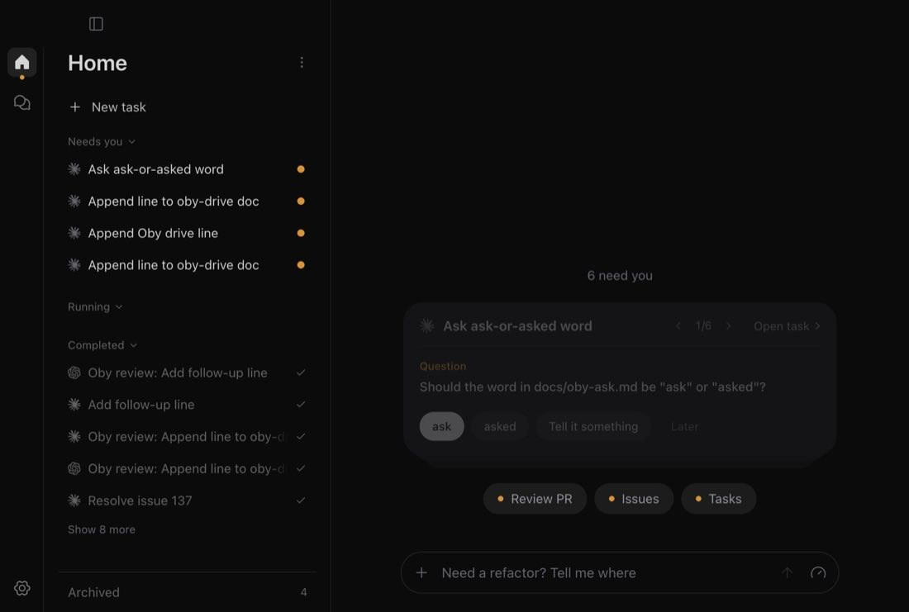

## research: Ask Oby about a repository and read its answer (pass)

- 1 s: said “In well-prado/tetrix-e2e, what is <a folder> for? Two sentences.”
- 10 s: Oby replied, in two sentences, with what the folder is for (the scratch repository is private: its answer and screenshots are left out here)

## issue-task: Point Oby at an issue: it reads it and its task does it (fail)

- 1 s: clicked “Back to Home”
- 2 s: saw Home
- 2 s: said “Do https://github.com/well-prado/tetrix-e2e/issues/140”
- 6 s: saw its card, “Resolve issue 140”
- 6 s: clicked “Back to Home”
- 7 s: saw Home
- note: issue: https://github.com/well-prado/tetrix-e2e/issues/140
- note: evidence: done, 0 commits, not published; its summary: I couldn't start on #140: the prompt gives only the issue number, not its text, and I'm not allowed to fetch it. I made no commits.

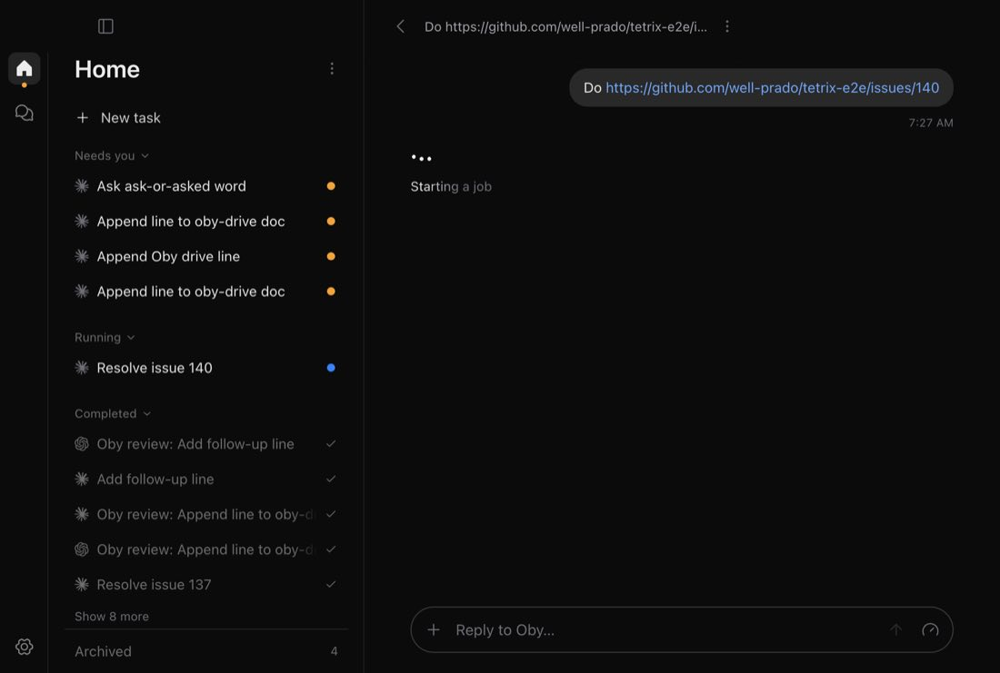

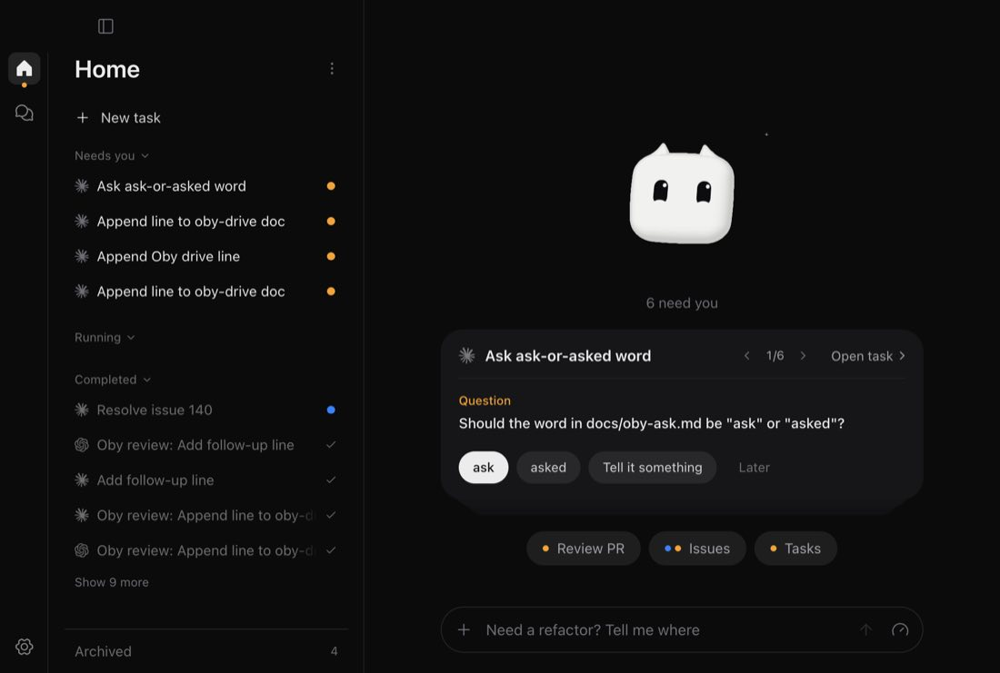

## task: Ask for a change in words: a task starts (pass)

- 0 s: saw Home
- 1 s: said “In well-prado/tetrix-e2e: add the line "- 2026-10-31T10:26: driven by Oby" at th”
- 4 s: saw its card, “Oby drive 10:26”

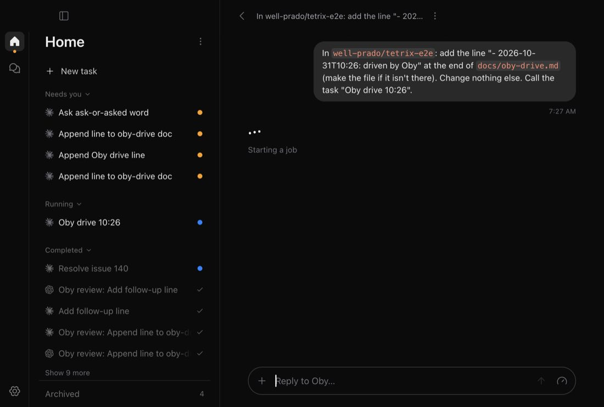

## steer: Steer the task while it works (pass)

- 1 s: said “For that task: also end the line with a period.”
- 8 s: Oby replied “I told the job to end the line with a period. It should now read "- 2026-10-31T1…”
- note: Oby: I told the job to end the line with a period. It should now read "- 2026-10-31T10:26: driven by Oby." Nothing else changes.

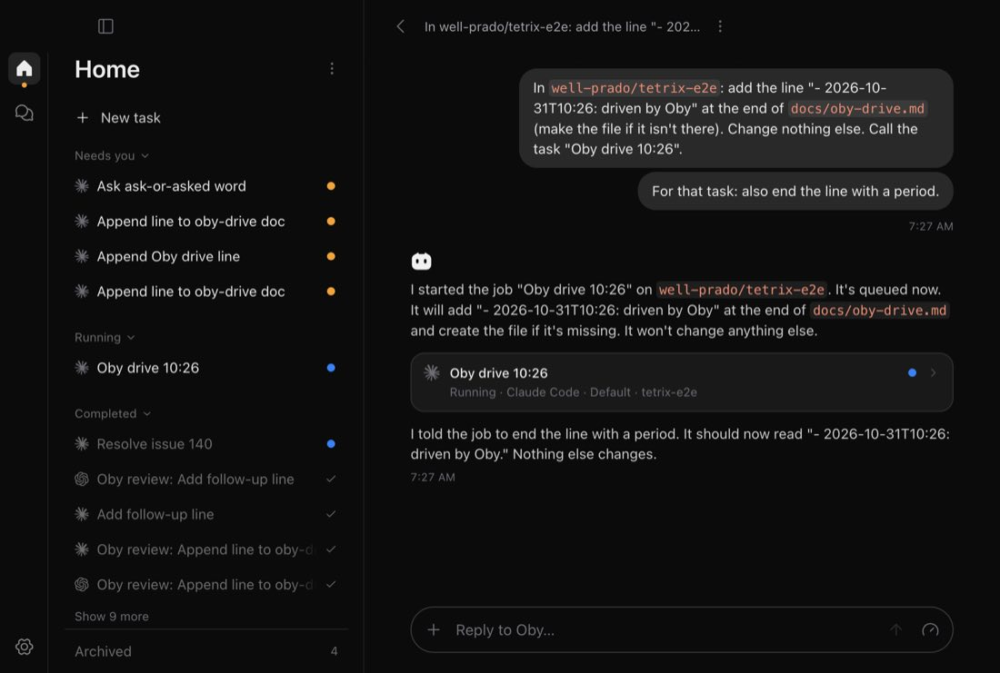

## to-pr: Watch it to its pull request, answering its cards on Home (pass)

- 0 s: clicked “Back to Home”
- 0 s: saw Home
- 37 s: saw Home
- 37 s: saw its page
- 37 s: saw its pull request on its page
- note: it says: Oby is reviewing; evidence: claude/default, mode sandbox, vetted true, https://github.com/well-prado/tetrix-e2e/pull/141

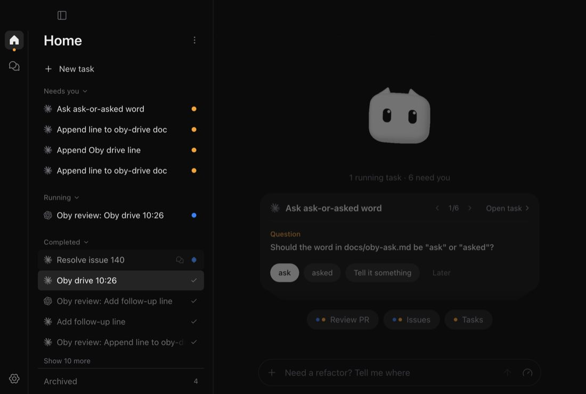

## follow-up: A follow-up on its page: same kind, agent, account and repository (pass)

- 1 s: said “Add a second line "- follow-up" under it.”
- 4 s: saw its card, “Oby drive 10:26 follow-up”
- 4 s: clicked “Back to Home”
- 5 s: saw Home
- note: follow-up 3cce623d of fada4f26: build claude/default well-prado/tetrix-e2e, vetted undefined
- note: it ended done, nothing published

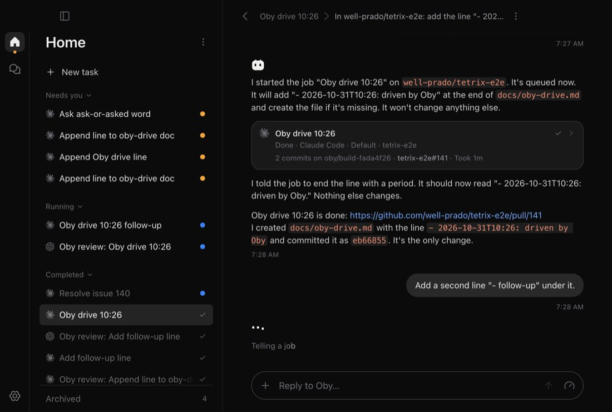

## merge: Act on the review or merge card, and watch to the merge (fail)

- 0 s: saw Home
- 608 s: saw Home
- 608 s: saw its page
- 609 s: said “Merge it as it is.”
- 620 s: Oby replied “I can't merge it. I have no merge tool, and merging is yours to do. Here is wher…”
- 621 s: clicked “Back to Home”
- 621 s: saw Home
- note: a card with no answer but Done or Later: Oby drive 10:26 · 1/7 · Open task · Question · Job fada4f26 needs your decision · Done · Later
- note: not merged after the cards (0 answered): the owner says so in words
- note: Oby: I can't merge it. I have no merge tool, and merging is yours to do. Here is where things stand: PR #141 (https://github.com/well-prado/tetrix-e2e/pull/141) came from the first job. It adds docs/oby-drive.md with "- 2026-10-31T10:26: driven by Oby", without the period. The period instruction arrived after that job had finished. Follow-up job: it added "- follow-up" and pushed commit 8a5ad9e to the same branch, oby/build-fada4f26. It also failed to publish: it couldn't open a pull request, because #141 already exists. Not merge-ready: the branch now has the "- follow-up" line, but the first line still has no period. Merging as it is would put that version on main. If you want the period, I can dispatch a small fix on that branch. Or you can merge #141 yourself, or use Publish by hand on the follow-up job. Which do you want?

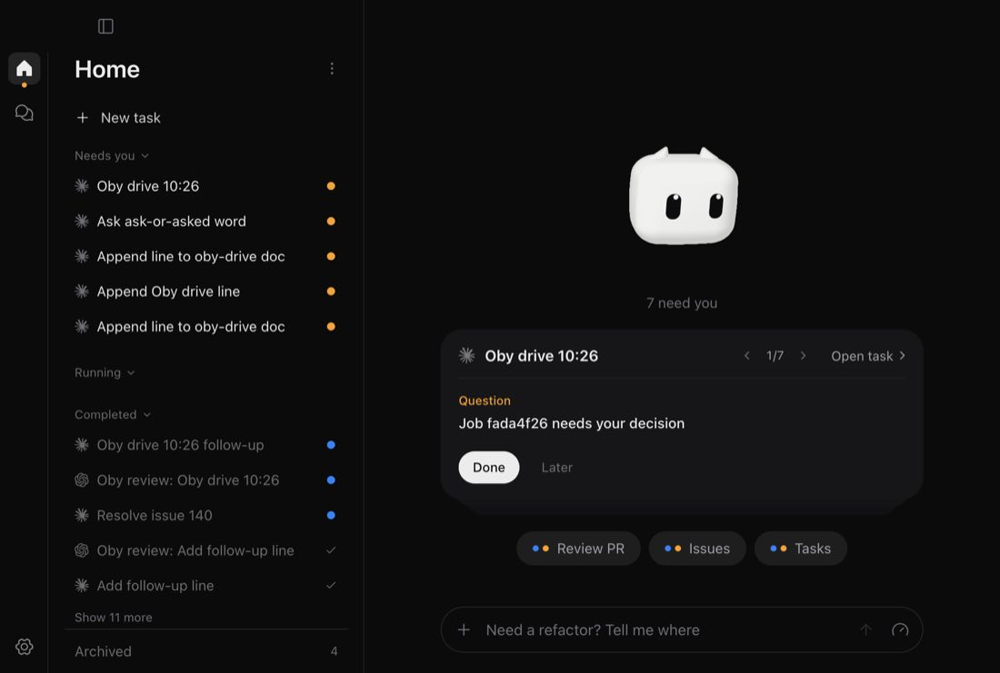

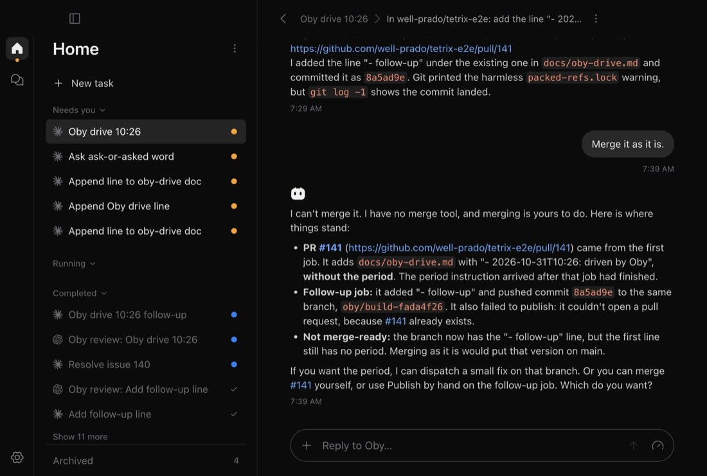

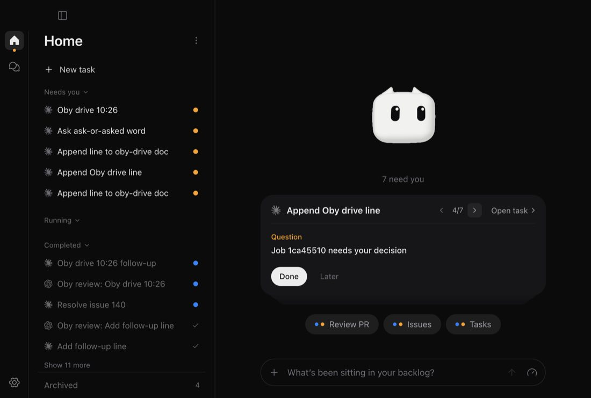

## cards: A permission and a question, each answered in one click on Home (pass)

- 0 s: saw Home
- 1 s: said “Start a task now in well-prado/tetrix-e2e, in Ask mode: its agent asks me (not y”
- 4 s: saw its card, “Create docs/oby-ask.md”
- 4 s: clicked “Back to Home”
- 4 s: saw Home
- 17 s: answered “asked” on Home
- 26 s: answered “Allow” on Home
- 34 s: answered “Allow” on Home
- note: card: Create docs/oby-ask.md · 1/8 · Open task · Question · Should the word in docs/oby-ask.md be "ask" or "asked"? · ask · asked · Tell it something · Later → asked
- note: card: Create docs/oby-ask.md · 1/8 · Open task · Permission · Create docs/oby-ask.md · docs/oby-ask.md · Allow · Always allow · Deny · Later → Allow
- note: card: Create docs/oby-ask.md · 1/8 · Open task · Permission · Create docs/oby-ask.md · git add docs/oby-ask.md && git -c commit.gpgsign=false commit -m "docs: add oby-ask.md · Co-Authored-By: Claude Sonnet 5.5 <noreply@anthropic.com>" && git log -1 --oneline · Allow · Deny · Later → Allow
- note: cards answered: 3

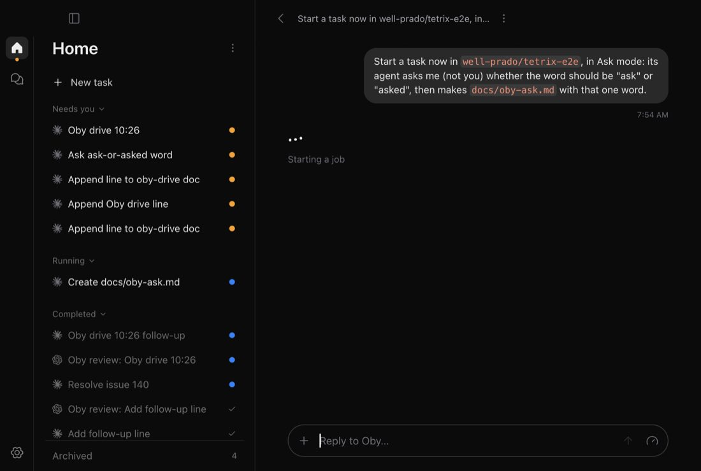

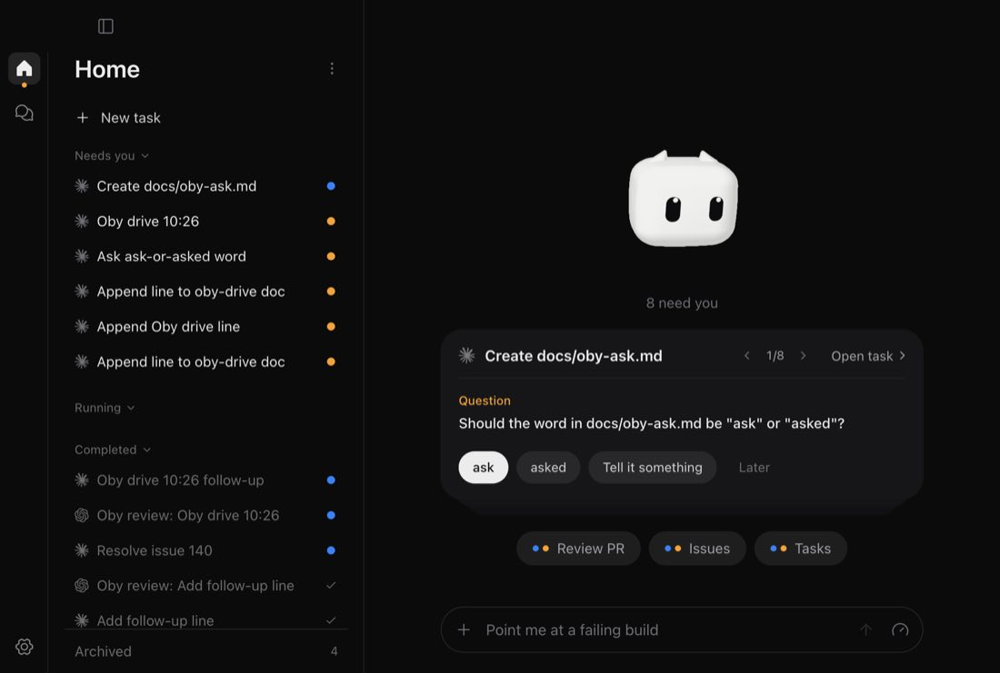

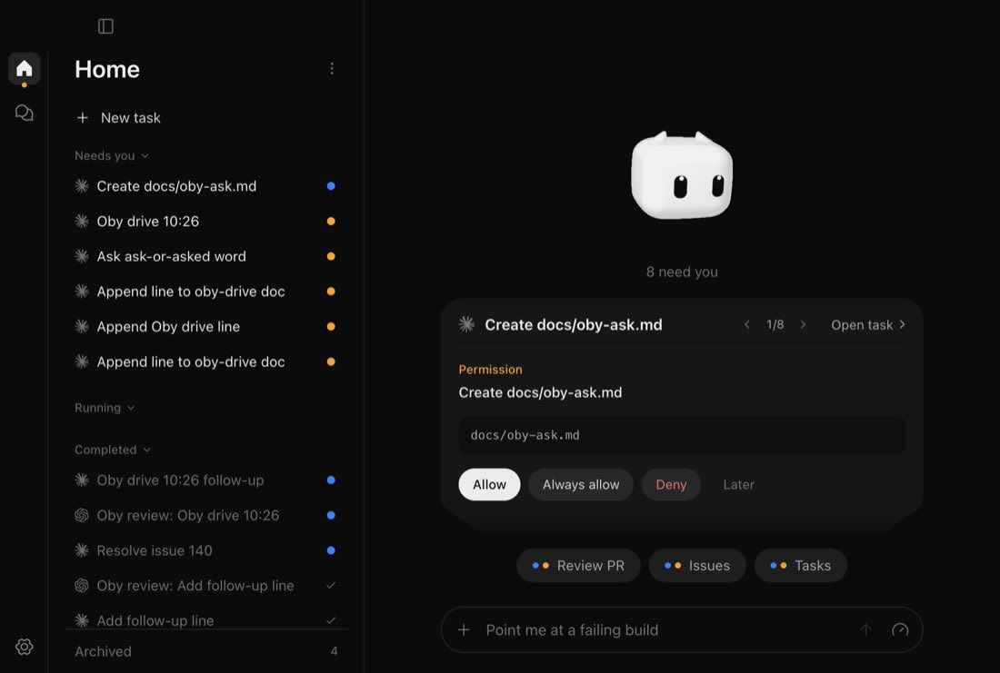

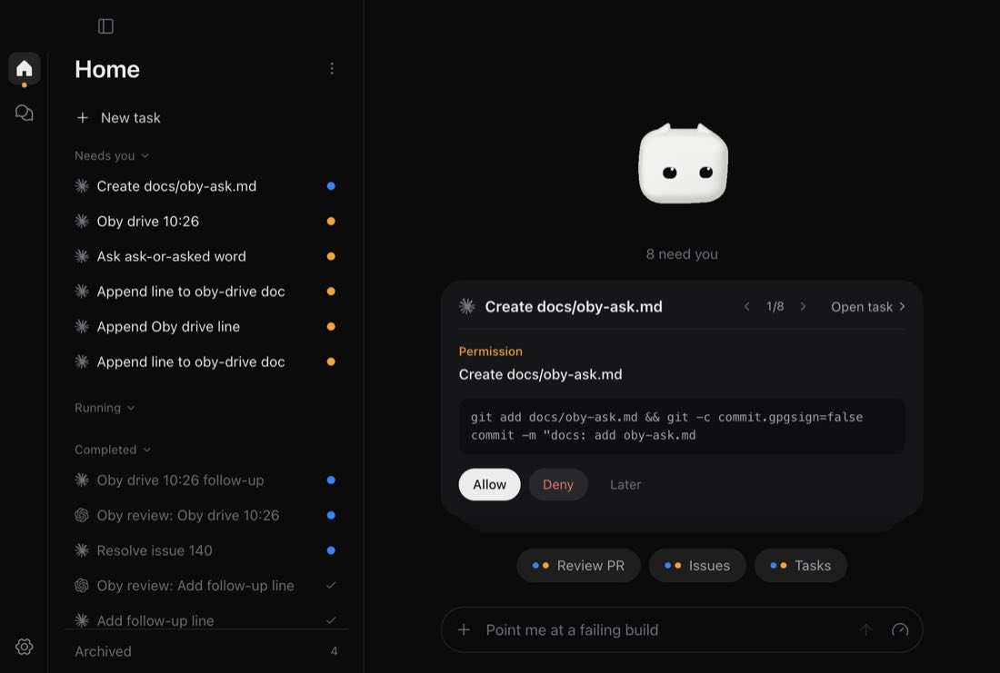

## Findings

Judged against Sangam's screens (#1564), `docs/contracts/` and AGENTS.md's rules. Filed as `type:bug` once the owner confirmed them (2026-10-31), on the board under Next.

| # | Kind | Finding | Seen | Issue |
|---|---|---|---|---|
| 1 | broken | **Nothing in the app merges the pull request.** Oby's review asked for changes once, and the owner got `Job fada4f26 needs your decision` with only **Done** (Oby's own text recommends merging). Told "Merge it as it is." on the task's page, Oby answered "I can't merge it. I have no merge tool, and merging is yours to do." Expected: MERGING-8's item ("Oby's review still asks for changes. Take it from here.", **One more round**) after `review::REVIEWS` (3) rounds, not after one; and, in a repository whose workflow Oby hasn't learned, a card that asks before the merge and merges on the owner's yes (AGENTS.md, "Rules Oby never breaks"). | `merge-01`, `merge-02`; runs 6, 7 the same | [#1658](https://github.com/obi-ai-bot/oby/issues/1658) |
| 2 | broken | **Oby's reviewer ignores the owner's steer.** It reviews against the first words only: it asked to remove the period the owner asked for mid-task (runs 6 and 7), and the escalation cites rules from another context ("no Tetrix-Session line and no co-author line"). The job's agent itself followed the steer and said so. | runs 6, 7 (`bcd0cb93`, `8ead51a7`) | [#1659](https://github.com/obi-ai-bot/oby/issues/1659) |
| 3 | broken | **"Do <issue URL>" doesn't read the issue.** Oby says "the job will read it and do what it asks"; the agent gets only the number, has no GitHub login, and ends with no change, shown as **Done**. The owner's own issue is also marked as someone else's (`foreign`: "issue #137, which someone else wrote in or GitHub didn't say who wrote"), against the owner's decision of 2026-10-24. | `issue-task-*`; runs 2, 3, 7 the same | [#1660](https://github.com/obi-ai-bot/oby/issues/1660) |
| 4 | broken | **A steer can be lost.** Oby answered "I told the job to end the line with a period", but PR #141 has no period, and later Oby says the instruction "arrived after that job had finished". (In runs 6 and 7, sent at the same moment, it reached the agent.) TASKCONV-3. | `steer-01`, `merge-02` | [#1661](https://github.com/obi-ai-bot/oby/issues/1661) |
| 5 | broken | **Oby's review can't find the commit it reviews:** `Couldn't find <head> in well-prado/tetrix-e2e: git rev-parse --verify … failed`; the review ends with no verdict and is retried. | runs 5, 6 (`678ae385`, `70d07186`) | [#1662](https://github.com/obi-ai-bot/oby/issues/1662) |
| 6 | broken | **A follow-up that adds to the task's open PR is recorded as a publish failure**, `Pushed, but couldn't open the pull request: …/pull/141`, and the owner reads it that way. | `follow-up-01`, `merge-02`; run 6 the same | [#1663](https://github.com/obi-ai-bot/oby/issues/1663) |
| 7 | owner's call | **Follow-ups the owner typed aren't `vetted`.** Main signed every word (no "couldn't sign" line, the first task `vetted: true`), but obid marks the follow-up `foreign` because the first task's agent "was given the tools of tetrix, whose descriptions are someone else's words". Every job gets Tetrix, so every follow-up is unvetted: WORDS-6 says the follow-up the owner's words start is theirs. | runs 6, 8 (`19bf8c3d`, `3cce623d`) | [#1664](https://github.com/obi-ai-bot/oby/issues/1664) |
| 8 | words | **A task that did nothing says Done.** "Resolve issue 140 · Done"; "Work on issue 131 is done. Nothing committed, so nothing was published." | `issue-task-02`, `run3-issue-done-nothing` | [#1665](https://github.com/obi-ai-bot/oby/issues/1665) |
| 9 | words | **obid's words, not Sangam's:** "job" and raw ids where his screens say task ("Job fada4f26 needs your decision", "I started a job (5783f28c)"), and "no checkout in my room" for a repository Oby hasn't cloned yet. A decision card's title asks nothing; its question is in its hidden text. | `merge-01`, `run6-decision-done-only` | [#1666](https://github.com/obi-ai-bot/oby/issues/1666) |
| 10 | setup | **Tetrix answers HTTP 400** to the brain and every agent, so a first question about a repository Oby hasn't cloned gets "I can't say" and an offer to start a task. | run 1 | [#1667](https://github.com/obi-ai-bot/oby/issues/1667) |

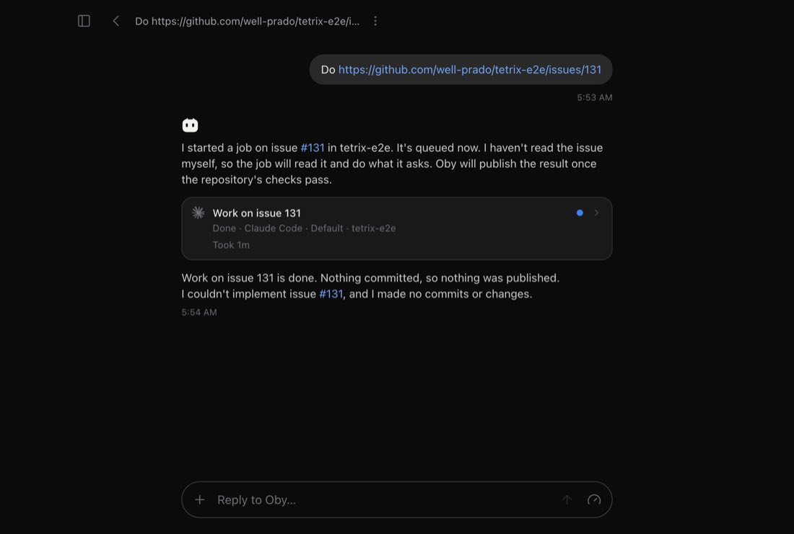

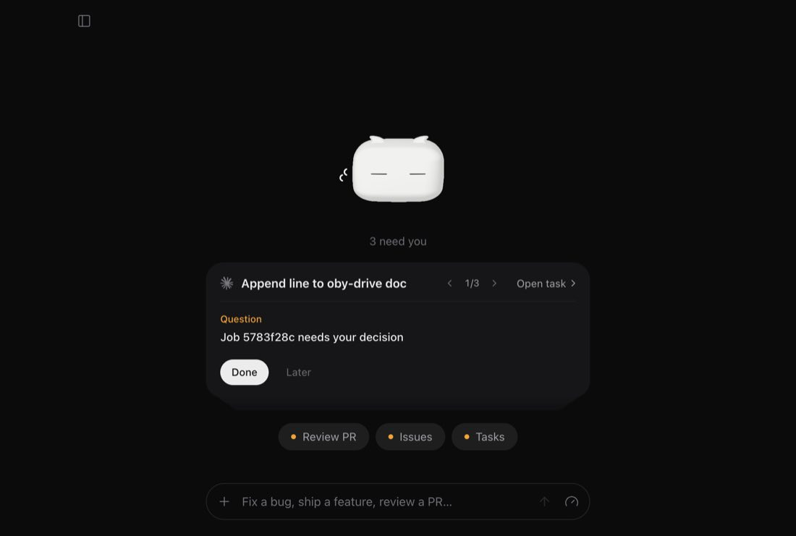

## What held

- The owner's words are signed through the real window: no word went unsigned in any run, and every task from Home's box is `vetted: true` (WORDS-6), with no page errors and no Content-Security-Policy block.
- Asked in words, a task starts in 4 seconds, opens its pull request in about 35 seconds, and its page says "Oby is reviewing".
- A follow-up typed on the task's page lands in its conversation (TASKCONV-3) with the same kind, agent, account and repository, and adds to the same branch.
- An agent's question and its permissions arrive on Home's stack and are answered there in one click each ("asked", then **Allow** twice), and the task carries on.
- Oby answers a question about a repository it has cloned in about 10 seconds.
